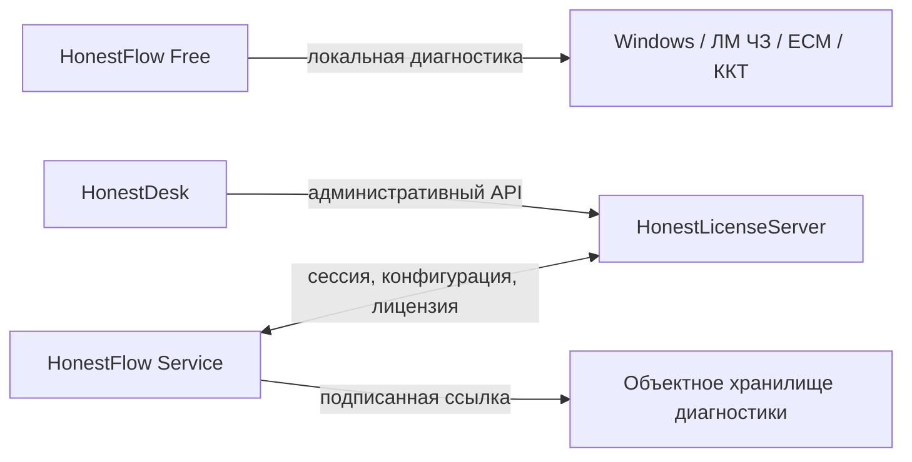

# HonestFlow

HonestFlow — WPF-клиент для диагностики и обслуживания кассового рабочего места с компонентами «Честного Знака». Он является частью экосистемы с [HonestDesk](https://github.com/1Yoda1/HonestDesk) и [HonestLicenseServer](https://github.com/1Yoda1/HonestLicenseServer).

## Режимы работы

| Режим | Назначение | Требует сервер или учётные данные |
|---|---|---|
| **Free** | Локальная диагностика этого компьютера | Нет |
| **Service** | Обслуживание компонентов, AutoFix, отправка диагностики и удалённая поддержка | Да |

При запуске всегда открывается **Free**. Он не создаёт идентификатор устройства, не требует интернет-соединения и не обращается к HonestLicenseServer. Подключение Service запускает пользователь через кнопку «Подключить Service»; приложение получает сессию, проверяет регистрацию устройства и действующие права, после чего переводит уже открытое окно в Service. Потеря или отзыв прав возвращают окно в Free, а не закрывают программу.

## Возможности

- диагностика ЛМ ЧЗ, контроллера, ТС ПИоТ/ЕСМ, драйвера и служб ККТ, локальных API и связей между компонентами;
- отображение найденных проблем в простом и подробном представлении;
- безопасный AutoFix: запуск и перезапуск известных служб, инициализация и восстановление ЛМ ЧЗ, регистрация ТС ПИоТ и выборочная установка компонентов; после каждого шага выполняется повторная проверка;
- плановая установка и переустановка компонентов с проверкой готовности рабочего места;
- сбор локального ZIP-архива диагностики;
- в Service — отправка архива в поддержку: архив загружается напрямую в настроенное объектное хранилище по короткоживущей подписанной ссылке, а сервер хранит только метаданные;
- запрос помощи и согласованная работа с RuDesktop. Пароль RuDesktop передаётся программе только через `--password`; локальный закрытый материал защищён DPAPI и не хранится в Git;
- проверка обновлений, файловое журналирование и ограниченная ротация журналов.

Автофикс намеренно не изменяет сетевые настройки, не запускает произвольные файлы и не может устранить физическое отключение ККТ, проблемы USB/COM или внешнюю недоступность ГИС МТ.

## Диагностические архивы

В Service пользователь сам выбирает состав архива. Перед отправкой HonestFlow показывает этапы формирования, загрузки и подтверждения доставки. Для локальной сборки архив можно открыть после завершения.

Архив не проходит через API-сервер: клиент получает разрешение на загрузку, отправляет файл непосредственно в объектное хранилище, затем подтверждает результат серверу. HonestDesk видит отправителя, рабочее место, время, размер, контрольную сумму и статус; загрузка и открытие доступны оператору по отдельной короткоживущей ссылке. Неиспользованные архивы автоматически удаляются из хранилища через 48 часов, а запись в истории остаётся.

Не включайте в диагностику пароли, токены, закрытые ключи и иные секреты.

## Архитектура



Основной production-путь — `App.xaml` → `App.OnStartup` → `LocalApplicationBootstrap` → `UI/MainWindow`. Устаревшие `Program.cs` и `Forms/` сохранены для справки и fallback-сценариев, но не являются местом для новых функций.

| Путь | Ответственность |
|---|---|
| `UI/` | WPF-окна, включая основное окно, прогресс операций и Service-диалоги |
| `Application/Bootstrap/` | Free-старт и сборка runtime-контекста |
| `Application/PointStatus/` | Диагностика, правила проблем, AutoFix и повторная проверка |
| `Application/Installation/` | Установка компонентов, подготовка ККТ и регистрация ТС ПИоТ |
| `Application/Licensing/`, `Application/ServiceConnection/` | Права Service и подключение к серверу |
| `Application/RemoteAccess/` | RuDesktop и запросы помощи |
| `Infrastructure/Api/` | Клиенты HonestLicenseServer и локальных API |
| `Infrastructure/` | Адаптеры служб Windows, установщиков, журналов, обновлений и конфигурации |
| `HonestFlow.Tests/` | xUnit-тесты |

## Сборка и тесты

Нужны Windows и .NET 10 SDK.

```powershell
dotnet restore HonestFlow.slnx
dotnet build HonestFlow.csproj -c Debug
dotnet test HonestFlow.Tests\HonestFlow.Tests.csproj -c Debug
```

Обычная Debug-сборка приложения находится в `bin\Debug\HonestFlow.exe`. Публикационный сценарий — `scripts\publish-honestflow.ps1`; он не должен содержать конфигурации клиентов, ключи, токены, базы данных или диагностические архивы.

## Безопасность и эксплуатация

- HonestLicenseServer — источник истины для клиентов, устройств, конфигурации и опубликованных лицензий.
- HonestFlow проверяет подписанные лицензии локально; закрытый ключ подписи в приложение не входит.
- Токены сессии принадлежат `ApiSessionService`; UI не дублирует логику bearer/refresh.
- Отправка диагностики и удалённая помощь доступны только при соответствующих разрешениях Service.
- Для установки компонентов и управления службами могут понадобиться права администратора.

Перед выпуском используйте [RELEASE_CHECKLIST.md](RELEASE_CHECKLIST.md). Ошибки и предложения: [GitHub Issues](https://github.com/1Yoda1/HonestFlow/issues).
