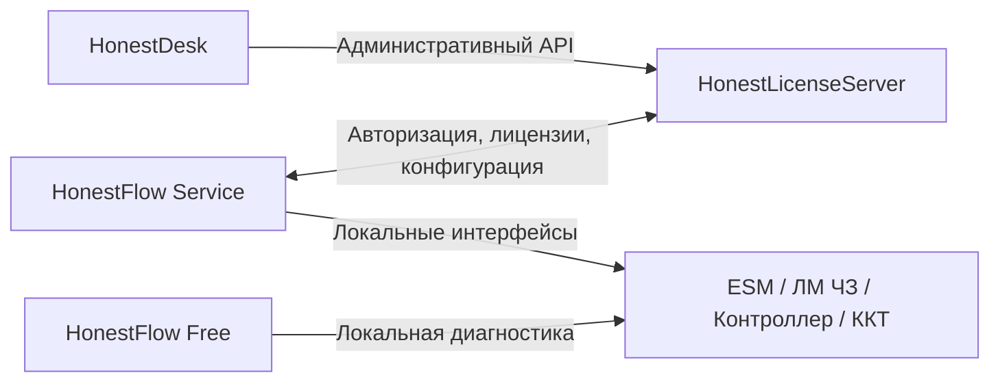

# HonestFlow 3.0

**Установка, настройка и диагностика ТС ПИОТ в одном приложении.**

HonestFlow — Windows-приложение для диагностики кассового рабочего места и автоматизации обслуживания программных компонентов, необходимых для работы с маркированными товарами. Оно объединяет проверку состояния компонентов, установку, настройку, регистрацию ТС ПИОТ и инструменты восстановления в одном интерфейсе.

**[Официальный сайт](https://honestflow.ru/)** · [Руководство пользователя](USER_GUIDE.md) · [Сообщить об ошибке](https://github.com/1Yoda1/HonestFlow/issues)

> **Текущий статус:** HonestFlow 3.0 находится в активной разработке. Ниже отдельно указаны возможности, представленные в коде, и направления развития. Наличие функции в исходниках не означает успешного испытания на любой конфигурации ККТ.

## Зачем нужен HonestFlow

Подготовка рабочего места для ТС ПИОТ обычно требует нескольких установщиков, настройки локальных модулей, проверки служб и соединения с ККТ. После установки инженеру нужно убедиться, что все компоненты доступны и взаимодействуют друг с другом.

HonestFlow помогает выполнять эти действия последовательно и видеть состояние рабочего места в одном окне. Приложение **не заменяет** программное обеспечение производителей ККТ и официальные компоненты маркировки: оно использует их установщики и предусмотренные интерфейсы взаимодействия.

## Free и Service

У приложения два режима: **Free** для просмотра состояния рабочего места и **Service** для сервисных операций.

| Возможность | HonestFlow Free | HonestFlow Service |
|---|:---:|:---:|
| Запуск без регистрации и ввода пароля | ✅ | — |
| Локальная диагностика рабочего места | ✅ | ✅ |
| Просмотр статусов компонентов, служб и доступных локальных интерфейсов | ✅ | ✅ |
| Просмотр фактически обнаруженных версий и конфигураций | ✅ | ✅ |
| Сопоставление с индивидуальными настройками и назначенными версиями клиента | — | ✅ |
| Установка и переустановка компонентов | — | ✅ |
| Автоматическая настройка и подготовка ККТ | — | ✅ |
| Регистрация ТС ПИОТ из приложения | — | ✅ |
| Сервисные операции и доступные автоматические исправления | — | ✅ |
| Централизованная конфигурация и права доступа | — | ✅ |

### HonestFlow Free

Free запускается сразу в основном WPF-окне. Для **локальной диагностики** не нужно создавать аккаунт, регистрировать устройство или получать лицензию с сервера.

Приложение проверяет доступные на компьютере компоненты, службы, локальные API, порты, версии и параметры. Набор и глубина результатов зависят от установленного ПО и доступности его интерфейсов. В Free не загружается индивидуальная серверная конфигурация торговой точки, поэтому проверка соответствия **назначенным клиенту версиям и настройкам** может быть недоступна.

Free не позволяет устанавливать, изменять или исправлять компоненты. Сервисные действия скрыты либо недоступны. Самостоятельный запуск Free не требует сервера лицензирования; при этом программа может отдельно обращаться к публичному источнику обновлений для проверки новой версии приложения.

### HonestFlow Service

Service активируется через кнопку **«Подключить Service»**. Доступ к операциям определяется действующей лицензией и разрешениями устройства. После подключения становятся доступны предусмотренные лицензией функции установки, настройки, обновления компонентов, обслуживания и восстановления.

При сохранённой разрешённой сессии приложение может восстановить подключение Service после открытия основного окна. В отсутствие действующего доступа локальная диагностика Free остаётся отдельным режимом.

## Поддерживаемые компоненты

| Компонент | Назначение в HonestFlow |
|---|---|
| **ESM (ТС ПИОТ)** | Проверка состояния и доступности локального API, диагностика регистрации и взаимодействия с ККТ, установка и обслуживание |
| **ЛМ ЧЗ (Regime)** | Диагностика готовности, установка, инициализация и предусмотренные операции восстановления |
| **ЛМ Контроллер** | Проверка службы и доступности, установка и обслуживание |
| **Драйвер АТОЛ** | Проверка наличия драйвера, установка подходящего пакета, взаимодействие с поддерживаемой ККТ |

Наличие компонента в списке не означает поддержку всех его версий, любых моделей касс или произвольных конфигураций ОС.

## Диагностика рабочего места

HonestFlow формирует общую картину состояния программных компонентов и оборудования. В зависимости от окружения доступны:

- проверка известных служб Windows и их состояния;
- проверка портов и доступности локальных API;
- получение статусов ЛМ ЧЗ, контроллера, ESM и связанных с ними экземпляров;
- обнаружение ККТ и проверка признаков её взаимодействия с компонентами;
- просмотр фактически обнаруженных версий и отдельных конфигурационных параметров;
- отображение проблем и, в Service, предусмотренных действий восстановления;
- сбор диагностических сведений для сервисного анализа.

**Важно:** успешный ответ локального API или работающая служба сами по себе не гарантируют корректность всех операций маркировки и фискализации. Результаты диагностики следует рассматривать вместе с состоянием кассы и требованиями конкретного рабочего места.

## Автоматическая установка и подготовка ККТ

В Service HonestFlow может сформировать план установки, получить необходимые дистрибутивы, установить и настроить компоненты, после чего повторно проверить состояние рабочего места.

В исходниках реализован отдельный сценарий подготовки ККТ, который предусматривает:

1. проверку необходимых условий и драйвера АТОЛ;
2. соединение с кассой через соответствующий драйвер;
3. ожидание обнаружения кассы в ESM;
4. повторную проверку после перезапуска ESM, если это требуется;
5. попытку регистрации ТС ПИОТ;
6. проверку результата и, по выбранному сценарию, ожидание состояния канала ГИС МТ.

Для полного автоматического сценария компьютер должен соответствовать требованиям компонентов, касса должна быть физически подключена и доступна, а для предусмотренного рабочего процесса требуется открытая смена. Реальные возможности зависят также от модели ККТ, драйвера, доступности сервисов и текущего состояния оборудования. **Автоматическое завершение на каждой конфигурации не гарантируется.** Проверка открытой смены как самостоятельное условие нуждается в дополнительном сквозном испытании.

## AutoFix: автоматическое исправление проблем

В HonestFlow уже предусмотрены планировщик исправлений, исполнитель операций и повторная диагностика после каждой попытки. Движок обрабатывает известные диагностические проблемы, выбирает доступные действия и не повторяет бесконечно неудачную операцию. Некоторые действия требуют подтверждения инженера.

В коде заложены сценарии перезапуска и запуска известных служб, инициализации и восстановления ЛМ ЧЗ, регистрации ТС ПИОТ и запуска интеллектуальной установки. **Поддержка конкретного исправления зависит от доступной операции, состояния рабочего места и разрешений Service.** При невозможности безопасно устранить проблему HonestFlow может потребовать действий пользователя.

**Развивается:** расширенные сценарии AutoFix, включая работу с сетевыми настройками, переадресацией портов и таймаутами. Эти направления не следует считать готовыми функциями стабильного релиза.

## Установка и первый запуск

1. Получите установщик из официального источника: **[honestflow.ru](https://honestflow.ru/)**. Доступность опубликованной сборки и её версия определяются текущим выпуском.
2. Запустите установщик на поддерживаемой 64-разрядной Windows. Для установки могут потребоваться права администратора.
3. При необходимости веб-установщик предложит установить **Microsoft .NET 10 Desktop Runtime**.
4. Откройте HonestFlow. По умолчанию отобразится главное окно с локальной диагностикой **Free**.
5. Для сервисных функций нажмите **«Подключить Service»** и выполните авторизацию в соответствии с предоставленным доступом.

**Требования:** Windows x64, .NET 10 Desktop Runtime, необходимые права на установку и обслуживание компонентов. Для установки и отдельных проверок необходим доступ к соответствующим источникам пакетов и API. Дополнительные требования определяются ESM, ЛМ ЧЗ, контроллером, драйвером АТОЛ и конкретной кассой. Универсальный минимальный объём ОЗУ или диска без проверки всех компонентов здесь не заявляется.

## Архитектура экосистемы

HonestFlow состоит из трёх связанных проектов:

| Проект | Назначение | Репозиторий |
|---|---|---|
| **HonestFlow** | Клиентская диагностика и сервисные операции на кассовом ПК | [GitHub](https://github.com/1Yoda1/HonestFlow) |
| **HonestLicenseServer** | Сервер авторизации, политик доступа, лицензий, версий, конфигураций и связанных сервисных API | [GitHub](https://github.com/1Yoda1/HonestLicenseServer) |
| **HonestDesk** | Администрирование клиентов, устройств, разрешений и версий компонентов | [GitHub](https://github.com/1Yoda1/HonestDesk) |



Free не зависит от авторизации на сервере лицензирования. Service использует централизованную модель управления доступом и настройками.

### Технологии HonestFlow

- **C# / .NET 10**, целевая платформа `net10.0-windows`;
- **WPF** — основной интерфейс версии 3.0;
- Windows Forms — сохраняющиеся вспомогательные и исторические части исходников; основной старый путь `Program.cs` и `Forms/` исключён из текущей сборки;
- локальные REST API, Windows Services и отдельные процессы установщиков;
- тесты на **xUnit**;
- публикация приложения для **win-x64**.

### Структура исходников

| Путь | Содержимое |
|---|---|
| `App.xaml.cs` | Актуальная точка запуска WPF, запуск Free и восстановление Service |
| `UI/` | Основное окно, диалоги и интерфейсы диагностики/обслуживания |
| `Application/Bootstrap/` | Инициализация локального Free и служебных сценариев |
| `Application/PointStatus/` | Сбор диагностических статусов, AutoFix и представление состояния точки |
| `Application/Installation/` | Установка, проверки версий, подготовка ККТ, регистрация ТС ПИОТ |
| `Application/Licensing/`, `Application/ServiceConnection/` | Политики сервисных операций и подключение Service |
| `Application/Diagnostics/` | Диагностические сведения и архивы |
| `Infrastructure/` | API-клиенты, работа со службами, загрузки, обновления и хранилища |
| `KktBootstrap/` | Вспомогательные x86/x64-процессы взаимодействия с драйвером |
| `HonestFlow.Tests/` | Автоматизированные тесты |
| `installer/`, `scripts/` | Веб-установщик и сценарии публикации |
| `Forms/`, `Program.cs` | Исторический WinForms-код, исключённый из актуальной сборки приложения |

## Сборка из исходников

Для сборки необходимы Windows и .NET 10 SDK. Из корня репозитория:

```powershell
dotnet restore HonestFlow.slnx
dotnet build HonestFlow.csproj -c Release
dotnet test HonestFlow.Tests\HonestFlow.Tests.csproj -c Release
```

Публикация Windows x64:

```powershell
.\scripts\publish-honestflow.ps1
```

Скрипт запускает тесты (если не указан `-SkipTests`) и публикует `HonestFlow.exe` в `bin\Release`. Проект при сборке также подготавливает вспомогательные процессы для x86/x64-взаимодействия с ККТ. Для сборки веб-установщика используется `scripts\build-web-installer.ps1` и Inno Setup.

> Не включайте в публичную сборку реальные конфигурации клиентов, лицензионные секреты, административные ключи, базы данных или диагностические архивы. Перед выпуском используйте [RELEASE_CHECKLIST.md](RELEASE_CHECKLIST.md).

## Лицензирование и безопасность

Free доступен без лицензии. Service требует действующих прав на конкретные сервисные операции. В реализации используются подписанные лицензионные данные и локально защищённое состояние; серверная часть отвечает за управление доступом и его актуализацию.

В репозитории опубликованы исходники приложения, но это **не означает автоматического разрешения** на коммерческое использование или распространение сторонних компонентов. Условия лицензирования самого HonestFlow и стороннего ПО необходимо проверять отдельно. Не передавайте пароли, токены и диагностические архивы через публичные задачи GitHub.

## Ограничения и планы развития

- **Уже представлено в исходниках:** локальный запуск Free; подключение Service; диагностика; установка и настройка компонентов; логика подготовки ККТ и регистрации ТС ПИОТ; базовый движок AutoFix; проверка обновлений приложения.
- **Требует испытаний в реальных конфигурациях:** надёжность комплексной автоматической подготовки различных моделей ККТ, проверка всех предусловий, обработка нестандартных версий ПО и инфраструктурных отказов.
- **В разработке:** расширение AutoFix, включая дополнительные сетевые сценарии, перенаправление портов, работу с таймаутами и расширенную диагностику сложных отказов.

Актуальность отдельных возможностей определяется конкретной сборкой приложения. Информация в README не заменяет документацию производителей используемых компонентов.

## Обратная связь

Сайт проекта: **https://honestflow.ru/**  
Ошибки и предложения: **[GitHub Issues](https://github.com/1Yoda1/HonestFlow/issues)**

---

© 2024–2026. HonestFlow. Автор проекта: Pavel Shadrov.
